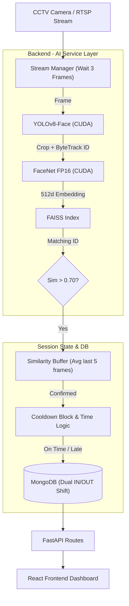

# Attendance AI: Enterprise CCTV Facial Recognition System

A state-of-the-art backend/frontend software architecture for processing massive real-time CCTV streams, autonomously recognizing faces, and compiling dense attendance shifts into an interactive web dashboard.

---

## 🚀 Quick Start (Run on Your Laptop)

### ✅ Prerequisites

Install these before anything else:

| Tool | Version | Download |
|------|---------|----------|
| Python | **3.12** | [python.org/downloads](https://www.python.org/downloads/) |
| Node.js | **20+** | [nodejs.org](https://nodejs.org/) |
| Git | Latest | [git-scm.com](https://git-scm.com/) |
| NVIDIA GPU | Optional | Falls back to CPU automatically |

---

### 📦 Step 1 — Clone the Repository

```powershell
git clone https://github.com/vishwab0815/COE-PROJECT.git
cd COE-PROJECT
```

---

### ⚙️ Step 2 — One-Time Setup

Run this **once only**. It automatically:
- Creates a Python virtual environment (`backend/venv`)
- Installs all Python dependencies (PyTorch, CUDA, FaceNet, FAISS, etc.)
- Downloads portable MongoDB into `mongodb/` *(no system install needed)*
- Installs React npm packages

```powershell
powershell -ExecutionPolicy Bypass -File scripts\setup.ps1
```

> ⏳ This may take 5–10 minutes on first run (downloading PyTorch + MongoDB).

---

### 🔑 Step 3 — Create Your `.env` File

```powershell
copy .env.example .env
```

Open `.env` and set at minimum:
```
ADMIN_PIN=1234
SECRET_KEY=any_long_random_string_here
```

> The defaults work fine for local testing. Do NOT commit your `.env` file.

---

### ▶️ Step 4 — Run the App

```powershell
scripts\start_app.bat
```

This opens **3 terminal windows** automatically:
- 🍃 **MongoDB** — local database (no install needed)
- ⚡ **FastAPI Backend** — `http://localhost:8000`
- ⚛️ **React Frontend** — `http://localhost:5173`

**Open your browser and go to:** 👉 **http://localhost:5173**

---

### 🛑 Step 5 — Stop the App

```powershell
scripts\stop_app.bat
```

---

### 🔧 Troubleshooting

**Backend fails with "Connection refused" to MongoDB?**

This happens when MongoDB has a stale lock file from a previous unclean shutdown. Fix it by running:

```powershell
Remove-Item data\db\mongod.lock -Force -ErrorAction SilentlyContinue
```

Then run `scripts\start_app.bat` again.

**Backend can't connect even after the fix?**

Make sure your `.env` has:
```
MONGO_URI=mongodb://127.0.0.1:27017
```
*(Use `127.0.0.1` instead of `localhost` to avoid IPv6 issues on Windows)*

---

## 🌐 URLs & Access

| URL | Description |
|-----|-------------|
| `http://localhost:5173` | React Dashboard (main app) |
| `http://localhost:8000/docs` | FastAPI Swagger API Docs |
| `http://localhost:8000/api/health` | Health Check |

**Admin Login PIN:** set via `ADMIN_PIN` in your `.env` (default: `1234`)

---

## ⚡ Core Architecture

The system utilizes an enterprise-grade `app` segregation, breaking logic into dedicated domains for scalability and maintenance.

### Flow Diagram



---

## 🏗 Directory Structure

```text
COE-PROJECT/
├── backend/
│   ├── app/                      # Enterprise Architecture Namespace
│   │   ├── api/routes/           # FastAPI route controllers
│   │   ├── core/                 # Config, DB connection, security
│   │   ├── models/               # Pydantic schemas
│   │   ├── services/             # AI pipeline (face_engine, stream_manager)
│   │   └── main.py               # Uvicorn entry point
│   └── venv/                     # Python virtual environment (auto-created)
├── frontend/                     # React + Vite app
│   └── src/
│       ├── components/           # Reusable UI components
│       ├── pages/                # Dashboard, Attendance, Register, etc.
│       └── services/api.js       # Axios API handler
├── mongodb/                      # Portable MongoDB binary (auto-downloaded)
├── data/db/                      # MongoDB data files (git-ignored)
├── scripts/
│   ├── setup.ps1                 # One-time setup script
│   ├── start_app.bat             # Start all services (dev mode)
│   ├── stop_app.bat              # Stop all services
│   ├── start_mongo.ps1           # Start MongoDB only
│   └── stop_mongo.ps1            # Stop MongoDB only
├── .env.example                  # Environment variable template
├── .env                          # Your local config (git-ignored, create from .env.example)
└── requirements.txt              # Python dependencies
```

---

## 🚀 Key Features

1. **YOLOv8 + ByteTrack Pipeline:** Face detection and tracking across frames using `yolov8n-face.pt` on GPU.
2. **Half Precision (FP16):** FaceNet runs in `.half()` mode — handles 40+ students at 10 FPS on a single GPU.
3. **Shift Tracking Configs:** Login/logout time thresholds stored in MongoDB — configurable live from the dashboard.
4. **No Training Needed:** YOLOv8 and FaceNet weights download automatically. Students are enrolled live from the **Register Student** page.
5. **Zero System Dependencies:** MongoDB runs as a bundled portable binary — no installation, no service, no admin rights.

---

## ⚙️ Configuration (`.env`)

| Variable | Default | Purpose |
|---|---|---|
| `MONGO_URI` | `mongodb://127.0.0.1:27017` | Database connection |
| `DB_NAME` | `attendance_db` | Database name |
| `CAMERA_SOURCE` | `0` | Webcam index or RTSP/HTTP URL |
| `SIMILARITY_THRESHOLD` | `0.70` | Min cosine similarity to accept a face match |
| `ADMIN_PIN` | `1234` | Admin login PIN |
| `SECRET_KEY` | random per start | Signs admin session tokens |
| `SESSION_MINUTES` | `5` | Admin session timeout |

---

## 🗄️ Database

MongoDB runs from `mongodb\bin\mongod.exe` with data stored in `data\db` — bound to `127.0.0.1:27017`, 256 MB cache, no Windows service needed.

| Action | Command |
|---|---|
| Start | `scripts\start_mongo.ps1` |
| Stop | `scripts\stop_mongo.ps1` |
| Logs | `data\mongod.log` |
| Backup | Stop MongoDB, then copy `data\db` folder |

---

## 🔐 API Access

All endpoints live under `/api`.

- **Public** (kiosk): `/video-feed`, `/stream/*`, `/recent-marked`, `/mark-attendance*`
- **Admin** (requires Bearer token from `POST /api/auth/login`): students, registration, reports, shift settings

> Run a **single** uvicorn worker — the camera, ByteTrack state and FAISS index are in-process singletons.
