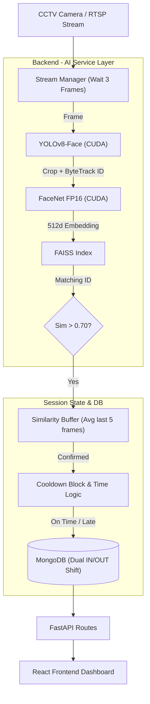

# Attendance AI: Enterprise CCTV Facial Recognition System

A state-of-the-art backend/frontend software architecture for processing massive real-time CCTV streams, autonomously recognizing faces, and compiling dense attendance shifts into an interactive web dashboard.

---

## ⚡ Core Architecture

The system utilizes an enterprise-grade `app` segregation, breaking logic into dedicated domains for scalability and maintenance.

### Flow Diagram



## 🏗 Enterprise Directory Structure

```text
attendance_ai/
├── backend/
│   ├── app/                      # Enterprise Architecture Namespace
│   │   ├── api/                  # FastAPI Application Controllers
│   │   │   └── routes/           # (students.py, attendance.py)
│   │   ├── core/                 # Foundation & Constants
│   │   │   ├── config.py         # ENV Ingestion
│   │   │   └── database.py       # Motor async connection pool
│   │   ├── models/               # Pydantic schemas required by API
│   │   ├── services/             # Distinct Business Logic
│   │   │   ├── face_engine.py    # YOLOv8 + FaceNet + FAISS CUDA Pipeline
│   │   │   └── stream_manager.py # Threading + Shift State Controller
│   │   ├── seed.py               # Bulk upsert CSV migration tool
│   │   └── main.py               # Uvicorn Bootstrapper
├── frontend/                     # React Server
│   ├── src/
│   │   ├── components/
│   │   │   └── dashboard/        # Decoupled stateless modules
│   │   ├── pages/                # Views (Dashboard.jsx)
│   │   └── services/             # Axios/Fetch api.js handler
├── .env                          # Secret Variables (See .env.example)
└── .gitignore                    # Comprehensive restriction overrides
```

## 🚀 Key Features

1. **YOLOv8 + ByteTrack Pipeline:** `MTCNN` is fully deprecated. Registration and frame parsing both rely entirely on `yolov8n-face.pt` running aggressively fast on GPU natively. Faces are dynamically tracked across frames before recognition, averting misidentifications from quick blur vectors.
2. **Half Precision (FP16):** Tensor operations for `InceptionResnetV1` run in `.half()` footprint mode, expanding concurrency threshold allowing massive 40-student 10FPS drops.
3. **Shift Tracking Configs:** Shift properties are stored inside `global_config` in MongoDB, instantly syncing IN/OUT behavior thresholds (e.g., Late vs On-Time vs Early Logout) dynamically off the frontend GUI without a hard reload.
4. **React Modularization:** The Dashboard is stripped away from unmaintainable inline components into segmented, independently scalable components (`ShiftSettings.jsx`, `StatCards.jsx`, `BranchBreakdown.jsx`, `ActivityFeed.jsx`).

## 🛠 Setup & Installation

Requirements: Windows, Python **3.12**, Node 20+, NVIDIA GPU (optional — falls back to CPU). No Docker and no system-wide MongoDB install needed.

**1. One-time setup** (creates `backend/venv`, installs CUDA 12.8 PyTorch + all deps, `npm ci`, downloads portable MongoDB into `mongodb/`, creates `.env`)
```powershell
powershell -ExecutionPolicy Bypass -File scripts\setup.ps1
```
Then edit `.env` — at minimum set **`ADMIN_PIN`** and **`SECRET_KEY`**.

No training is needed: the YOLOv8-face detector is pretrained and downloaded on first start,
FaceNet (VGGFace2) weights download automatically, and the FAISS index starts empty —
students are enrolled live from the **Register Student** page.

**2. Production run** (local MongoDB + built React app served by FastAPI)
```powershell
scripts\start_prod.bat            # or: scripts\start_prod.ps1 -Rebuild  to rebuild the frontend
```
Open `http://localhost:8000` (API docs at `/docs`, health at `/api/health`).

**3. Development run** (hot reload; Vite on :5173 proxies `/api` to :8000)
```powershell
scripts\start_app.bat
```

### Database (local, inside the project)

MongoDB runs from `mongodbin\mongod.exe` with its data in `data\db` — bound to `127.0.0.1:27017`,
256 MB cache, no service, nothing installed on Windows. Both folders are git-ignored.

| Action | Command |
|---|---|
| Start (also done by the start scripts) | `scripts\start_mongo.ps1` |
| Stop cleanly (also done by `stop_app.bat`) | `scripts\stop_mongo.ps1` |
| Back up | stop MongoDB, then copy the `data\db` folder |
| Logs | `data\mongod.log` |

### Configuration (`.env`)

| Variable | Default | Purpose |
|---|---|---|
| `MONGO_URI` / `DB_NAME` | `mongodb://localhost:27017` / `attendance_db` | Database |
| `CAMERA_SOURCE` | `0` | Webcam index or RTSP/HTTP URL |
| `SIMILARITY_THRESHOLD` | `0.70` | Min cosine similarity to accept a match |
| `ADMIN_PIN` | `1234` | Admin login PIN (verified server-side) |
| `SECRET_KEY` | random per start | Signs admin session tokens |
| `SESSION_MINUTES` | `5` | Admin session length |
| `CORS_ORIGINS` | Vite dev origins | Only needed when frontend is on another origin |

### API & access

All endpoints live under `/api`. Admin endpoints (students, registration, reports, shift settings)
require the `Authorization: Bearer <token>` header from `POST /api/auth/login`.
Kiosk endpoints (`/video-feed`, `/stream/*`, `/recent-marked`, `/mark-attendance*`) are public.

> Run a **single** uvicorn worker — the camera, ByteTrack state and FAISS index are in-process singletons.
